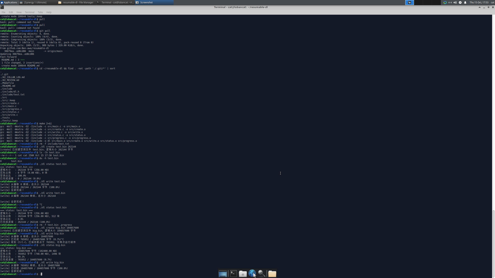

# 基于文件 IO 的空洞文件「断点续传」下载器

## 前言

本项目是鲁班猫（RK3566 / aarch64 / Linux）编程作业，选题为「基于文件 IO 的空洞文件断点续传下载器」。

整个程序的思路很简单：先用 `ftruncate` 造一个逻辑上很大、但实际不占磁盘的**空洞文件**，再用 `lseek` + `write` 往指定偏移处**定点写入**，每写完一块就把进度落盘，这样即使中途 `Ctrl-C` 退出，下次也能从断点继续。

写这份作业的过程也是和 AI 协作的过程，AI 的使用记录、审查意见和测试用例都放在了仓库里，见下文「AI 元素」。

## 功能

程序提供三个子命令：

- `create` —— 创建空洞文件，逻辑大小 ≥ 128KB，不写入数据、不占磁盘块
- `write`  —— 按块模拟下载，使用 `lseek` + `write` 定点写入，支持 `Ctrl-C` 中断与续传
- `status` —— 打印逻辑大小、实际占用块数、空洞占比、已完成进度

## 目录结构

resumable-dl/
├── Makefile # 编译脚本
├── README.md # 本文档
├── AI_COLLAB_LOG.md # AI 协作日志
├── AI_REVIEW.md # AI 代码审查
├── include/
│ └── dl.h # 公共头文件
├── src/
│ ├── main.c # 命令分发
│ ├── create.c # 创建空洞文件
│ ├── write.c # 定点写入 + 断点续传
│ ├── status.c # 查看文件状态
│ └── progress.c # 进度记录读写
└── tests/
└── test_cases.md # 测试用例

## 编译

make
生成可执行文件 dl。

清理编译产物：
make clean

## 使用  
### 创建空洞文件  
./dl create test.bin 262144  
*262144 即 256KB，省略则默认 256KB（要求 ≥ 128KB）。*

### 验证稀疏性：
ls -lh test.bin    # 逻辑大小 256K  
du  -h test.bin    # 实际占用 0
ls 显示 256K、du 显示 0，就说明确实是空洞文件。  

### 模拟下载：
./dl write test.bin  
按 4KB 一块逐块写入，每写完一块更新 .progress。中途按 Ctrl-C 可中断，再次运行会从断点继续。  

### 查看状态
./dl status test.bin 
输出逻辑大小、实际占用字节、块数、空洞占比与已完成进度。 

## 实现原理
空洞文件依赖 Linux 的稀疏文件机制：文件有一层「逻辑大小」，但只有真正写入过的块才会分配磁盘块，未写入的区域就是「空洞」。

* ftruncate(fd, size) 直接把文件逻辑大小设为 size，不产生任何数据块； 
* lseek(fd, off, SEEK_SET) 把文件偏移定位到 off，再 write 就只影响这一小段，其他空洞不受影响； 
* stat 返回的 st_size 是逻辑大小，st_blocks 是实际占用的 512 字节块数，两者一减就是空洞占比。 

断点续传靠一个 .progress 文本文件记录 target / total / done。每写完一块就保存一次；Ctrl-C 触发 SIGINT，处理函数置标志位让主循环退出并落盘，下次从 done 处续写。 

## AI元素
本项目为「AI 协作版」作业，AI 使用情况见：

* AI_COLLAB_LOG.md —— 与 AI 的协作记录（prompt、采纳/拒绝）  
* AI_REVIEW.md —— AI 代码审查出的缺陷（现象 / 根因 / 验证）  
* tests/test_cases.md —— AI 辅助设计的测试用例

## 运行截图

##最后

代码和文档都还很粗糙，如果有问题欢迎在 Issues 中指出。
